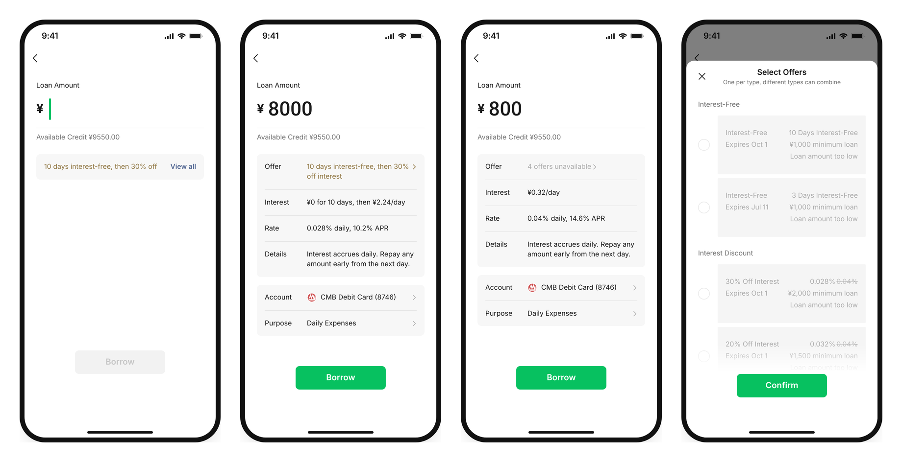

# Offer Row

A working rebuild of the offer row I designed for the WeChat Pay Fenfu loan page.

**[Try it live →](https://shuyii0315-arch.github.io/offer-row/)**



## The problem

On the loan page, the offer row used to disappear as soon as the amount stopped fitting a coupon. People who had a coupon
couldn't tell where it went, and support tickets followed. The redesign keeps the row in place and says what changed:
which offer is applied, how many don't fit, and why.

This repo shows that behaviour running, not just drawn.

## Try these

| Amount | What happens |
|---|---|
| ¥8,000 | Every coupon fits. The best pair is applied: 10 days interest-free, then 30% off. |
| ¥1,500 | Some fit. The best ones that fit are applied. |
| ¥800 | Nothing fits. The row stays and says "4 offers unavailable". Tap it to see why. |
| Borrow | Credit goes down, used coupons are gone, and the best one left comes back as a reminder. |

On a computer you can type the amount on your keyboard; Enter confirms, Esc closes.

## How it's built

The rules live in one plain JavaScript function with no UI, no framework and no dependencies.
The React page only renders what it returns.

```js
getOfferBar({ amount: 800, coupons })
// → { state: 'unavailable', text: '4 offers unavailable', action: 'viewWhy', … }
```

```
core/
  offerBar.js          the rules, framework-free
  offerBar.test.mjs    one assertion per rule
  sampleCoupons.js     demo data (credit ¥9,550, four coupons)
  tokens.json          colours and timing from the Figma file
demo/                  React + Vite page that renders the rules
```

| Rule | |
|---|---|
| R1 | No coupons → no offer row. Nobody sees an empty promise. |
| R2 | Coupons exist but none fit → the row stays and says how many are unavailable. |
| R3 | The row names exactly what is applied, never a generic "discount applied". |
| R4 | Every unavailable coupon states what limits it. |
| R5 | While matching, the row keeps its place; only the content changes. |
| R6 | One coupon per type; different types combine. |
| R7 | Best coupon: more free days → higher max amount → lower minimum → earlier expiry. |
| R8 | The best pick is a default, not a lock: the user can switch or drop a coupon per type. |
| R9 | After a loan, credit goes down, used coupons are gone, and the best one left is offered back. |

Because the rules don't know about React, an engineer can lift `core/` into the real app and keep the UI layer that
already exists there.

## Run it

```bash
cd demo
npm install
npm run dev     # local preview
npm test        # checks every rule
npm run build   # single-file build in demo/dist
```

Pushing to `main` deploys to GitHub Pages through `.github/workflows/deploy.yml`.

## Notes

- All amounts and coupons are demo data. Nothing connects to a real account.
- Numbers use WeChat Sans when it is installed. Otherwise they fall back to Roboto (Apache 2.0, bundled), the closest
  open font in a digit-by-digit comparison. WeChat Sans itself is not included.
- Screens, icons and spacing follow my own design file for this project.

Designed and built by Shuyi Yuan.
